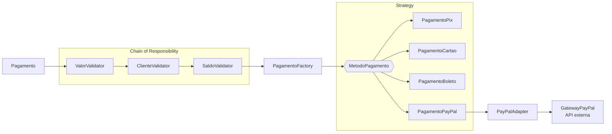

# Sistema de Pagamentos · Design Patterns

Sistema de pagamentos em **Java 21** que aceita PIX, cartão, boleto e PayPal, organizado com quatro design patterns clássicos: **Strategy**, **Factory**, **Chain of Responsibility** e **Adapter**.

O projeto tem três formas de uso:

- **Console** (`Main.java`): o exemplo original, que imprime o fluxo no terminal.
- **API REST** (Spring Boot): executa o mesmo fluxo e devolve o que cada classe fez.
- **Interface web** (React + TypeScript): uma apresentação em slides sobre os padrões e um simulador que chama a API e anima cada etapa.

---

## Os padrões

| Padrão | Tipo | Onde | Problema que resolve |
|---|---|---|---|
| **Strategy** | Comportamental | `strategy/` | Cada forma de pagamento é uma classe que implementa `MetodoPagamento`. Um meio de pagamento novo vira uma classe nova, sem mexer no código existente. |
| **Factory** | Criacional | `factory/` | `PagamentoFactory.criar("PIX")` devolve a estratégia certa. Quem chama depende só da interface. |
| **Chain of Responsibility** | Comportamental | `chain/` | Os validadores de valor, cliente e saldo ficam encadeados. Cada um verifica uma regra e passa para o próximo, ou interrompe o fluxo. |
| **Adapter** | Estrutural | `adapter/` | `PayPalAdapter` converte a chamada do sistema para a API externa `GatewayPayPal`, que tem outra interface. |

Esses padrões também ajudam a seguir os princípios SOLID, principalmente **Open/Closed** (dá para estender sem modificar) e **Single Responsibility** (cada classe tem uma única responsabilidade).

## Fluxo de um pagamento



Quem monta e executa esse fluxo é o `ProcessadorPagamento`. Se qualquer etapa lançar uma `IllegalArgumentException`, o pagamento é recusado e o motivo é informado.

---

## Como rodar

### Requisitos

- **Java 21** e **Maven 3.9+**
- **Node.js 20+**, só para a interface web

### 1. Console

Rode a classe `com.thiago.pagamentos.Main` pela IDE. A saída esperada:

```text
=================================
     SISTEMA DE PAGAMENTOS
=================================

Pagamento solicitado:
Pagamento{cliente='Thiago Brito', valor=400.0, metodo='CARTAO'}

Validando pagamento...
✓ Valor validado.
✓ Cliente validado.
✓ Saldo validado.

✓ Todas as validações foram aprovadas.
criar("CARTAO") → new PagamentoCartao()

Processando pagamento...
Processando pagamento via cartão...
Pagamento de R$ 400,00 realizado no cartão para Thiago Brito.

✓ Pagamento concluído com sucesso!
```

### 2. API (Spring Boot)

```bash
mvn spring-boot:run
```

Outra opção é rodar `PagamentosApiApplication` pela IDE. A API sobe em `http://localhost:8080`.

### 3. Interface web

```bash
cd frontend
npm install
npm run dev
```

Abra `http://localhost:5173`. Se a API estiver desligada, o simulador usa uma versão do fluxo em TypeScript, então a apresentação funciona mesmo sem o backend.

---

## API

### `POST /api/pagamentos`

Processa um pagamento.

**Requisição**

```json
{
  "cliente": "Ana Souza",
  "valor": 900,
  "metodo": "PIX",
  "saldoDisponivel": 500
}
```

`metodo` aceita `PIX`, `CARTAO`, `BOLETO` ou `PAYPAL`. Qualquer outro valor é recusado pela Factory.

**Resposta**

```json
{
  "aprovado": false,
  "motivo": "Saldo insuficiente. Saldo disponível: R$ 500,00",
  "falhouEm": "SaldoValidator",
  "linhas": [
    { "padrao": "sistema", "origem": "ProcessadorPagamento", "mensagem": "Validando pagamento...", "nivel": "info" },
    { "padrao": "chain", "origem": "ValorValidator", "mensagem": "✓ Valor validado.", "nivel": "sucesso" },
    { "padrao": "chain", "origem": "ClienteValidator", "mensagem": "✓ Cliente validado.", "nivel": "sucesso" },
    { "padrao": "sistema", "origem": "ProcessadorPagamento", "mensagem": "✗ Pagamento recusado.", "nivel": "erro" }
  ]
}
```

(As linhas estão resumidas.) Em `linhas` vem tudo o que foi impresso durante a execução, com a classe (`origem`) e o pacote (`padrao`) de cada linha. `falhouEm` diz qual classe interrompeu o fluxo.

### `GET /api/pagamentos/status`

Diz se a API está no ar e qual versão do Java ela usa, por exemplo `{ "java": "21.0.9+7-LTS-338" }`.

---

## Estrutura

```text
.
├── pom.xml
├── src/main/java/com/thiago/pagamentos/
│   ├── Main.java                   # versão de console
│   ├── ProcessadorPagamento.java   # orquestra o fluxo completo
│   ├── ResultadoPagamento.java
│   ├── model/                      # Pagamento
│   ├── chain/                      # Chain of Responsibility: validadores
│   ├── factory/                    # Factory: PagamentoFactory
│   ├── strategy/                   # Strategy: Pix, Cartão, Boleto, PayPal
│   ├── adapter/                    # Adapter: PayPalAdapter + GatewayPayPal
│   ├── saida/                      # Saida: imprime no console e captura para a API
│   └── api/                        # Spring Boot: aplicação e controller
└── frontend/
    └── src/
        ├── slides/                 # apresentação (9 slides)
        ├── Simulador.tsx           # simulador do fluxo
        ├── domain/api.ts           # cliente da API
        └── domain/pagamentos.ts    # versão do fluxo em TypeScript (usada sem backend)
```

## Interface web

- **Apresentação:** 9 slides com o código importado direto dos arquivos `.java`, então os slides acompanham o código. Atalhos: `←` e `→` para navegar e `F` para tela cheia. Cada slide tem link próprio (`#/slides/3`).
- **Simulador:** tem cenários prontos (aprovado, PayPal, saldo insuficiente, valor zero, sem cliente e método inválido) e mostra cada etapa acendendo na cor do seu padrão.
- Funciona no celular e respeita a opção de reduzir animações do sistema.

Mais detalhes em [`frontend/README.md`](frontend/README.md).

## Tecnologias

**Backend:** Java 21 · Spring Boot 3.5 · Maven
**Frontend:** React 19 · TypeScript · Vite · Tailwind CSS 4 · Motion · Lucide

## Observação para Windows

Em algumas máquinas Windows, o Tomcat não sobe e mostra o erro *"Unable to establish loopback connection"*. Isso acontece porque o JDK não consegue criar um socket local na pasta TEMP. O `PagamentosApiApplication` já contorna isso sozinho, usando a pasta `~/.sistema-pagamentos/tmp`.

---

Feito por **Thiago Brito**.
